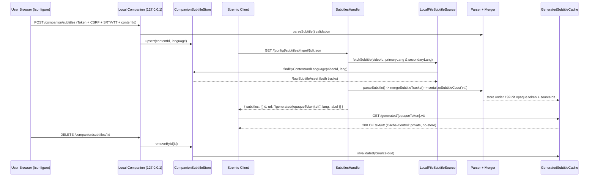

# SubtitleMe — Stremio Addon Architecture (Sprint 10 MVP)

## 1. Architectural Overview

`apps/stremio-addon` is a standalone local-first Node.js TypeScript workspace (`@subtitleme/stremio-addon`, v0.2.0-mvp) that reuses SubtitleMe's shared monorepo core without duplicating parsing or merging logic and without modifying `apps/chrome-extension`.

Shared workspace dependencies:
- `@subtitleme/shared-types` — `SubtitleCue`, `SubtitleTrack`, `SubtitleFormat`, `SubtitleOrder`
- `@subtitleme/subtitle-parser` — deterministic `parseSubtitle()` for SRT and WebVTT
- `@subtitleme/subtitle-core` — `mergeSubtitleTracks()` and `serializeSubtitleCues('vtt')`
- `stremio-addon-sdk@1.6.10` — official `addonBuilder` and `getRouter()`

---

## 2. Layered Module Structure

| Layer | Directory | Responsibility |
| :--- | :--- | :--- |
| **Local Companion** | `apps/stremio-addon/src/companion/` | Loopback-only (`127.0.0.1`) subtitle ingestion, validation, 256-bit ephemeral session auth with TTL + Host/DNS rebinding guard, CSRF/Origin checks, optional atomic disk persistence (`CompanionPersistence`), lifecycle (`checkPortAvailable`, `attachGracefulShutdown`), and derived cache invalidation |
| **Configure UI** | `apps/stremio-addon/src/configure/` | Modern Dark web UI served at `/configure` (persistence toggle, storage metrics, recovery badge, destructive confirmations, manifest status) + Stremio install URL serializer (`/:encodedConfig/manifest.json`) |
| **Subtitle Sources** | `apps/stremio-addon/src/sources/` | Pluggable `SubtitleSourceProvider`: `LocalFileSubtitleSource` (primary MVP source), `CompositeSubtitleSource` (local-first with opt-in fallback), `OpenSubtitlesSourceProvider` (opt-in REST v1 contract), and `MockFixtureSubtitleSource` (authorial fixtures) |
| **Addon Protocol** | `apps/stremio-addon/src/addon/` | Configurable `manifest.json` (`resources: ['subtitles']`) and resilient `subtitles` handler |
| **VTT Delivery & Cache** | `apps/stremio-addon/src/delivery/` | `SubtitleFileService` + `GeneratedSubtitleCache` with 192-bit opaque random tokens, session isolation, LRU eviction, 200-entry / 20 MB / 15-min TTL caps, and source-ID invalidation |
| **HTTP Server** | `apps/stremio-addon/src/server/` | Single Node.js `http.createServer` strictly bound to `127.0.0.1` mounting Companion, Configure UI, `/generated/:token.vtt`, `/health`, and `stremio-addon-sdk` `getRouter()` |

---

## 3. End-to-End MVP Flow

---

## 4. Controlled Failure & Edge-Case Behavior

- **Both tracks available**: Returns 1 combined bilingual WebVTT track (`SubtitleMe — <Primary> + <Secondary>`).
- **Only one track available**: Returns `{ subtitles: [] }` cleanly (never mislabels a single-language subtitle as bilingual).
- **No tracks available / wrong contentId**: Returns `{ subtitles: [] }`.
- **Equal languages / invalid offset / disabled bilingual toggle**: Rejected by `validateAddonConfig()` → `{ subtitles: [] }`.
- **Invalid or spoofed file**: Rejected at upload (`400` / `413`), never stored or merged.
- **Track deleted**: Immediately invalidates all derived VTT tokens (`404 Not Found`).
